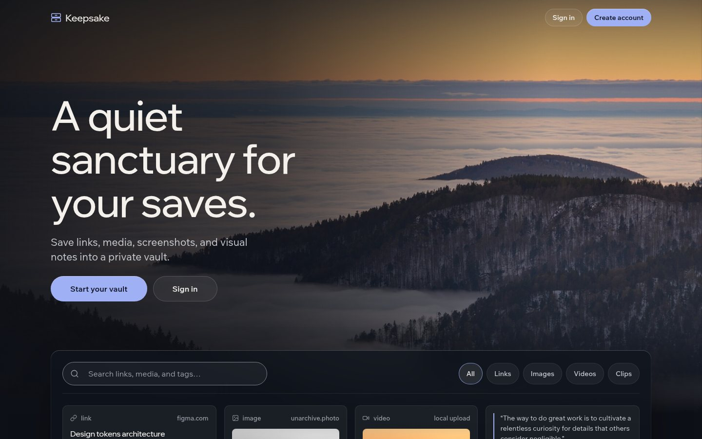
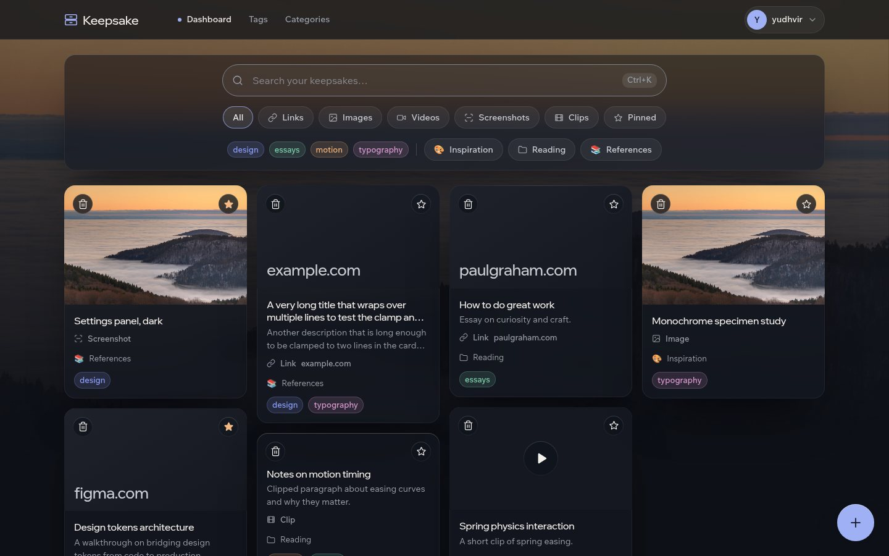
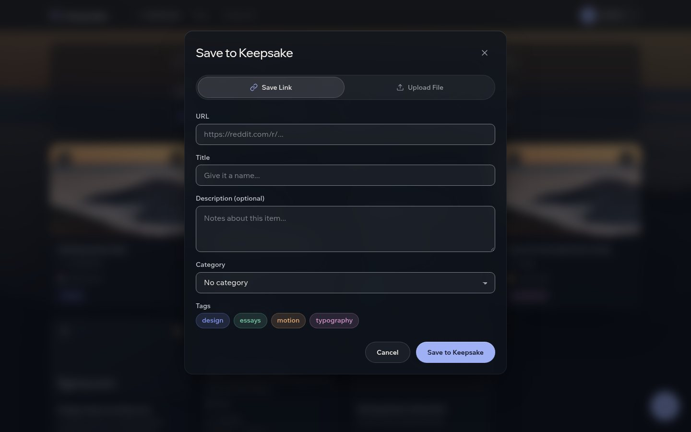
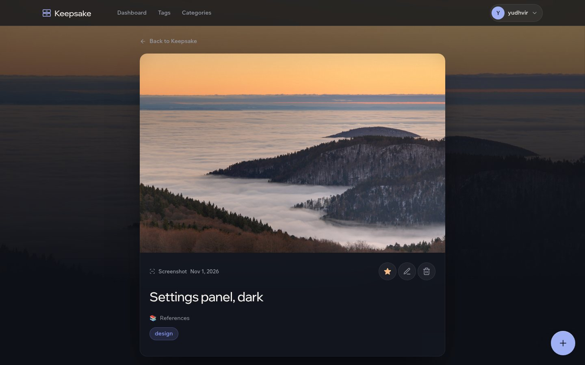
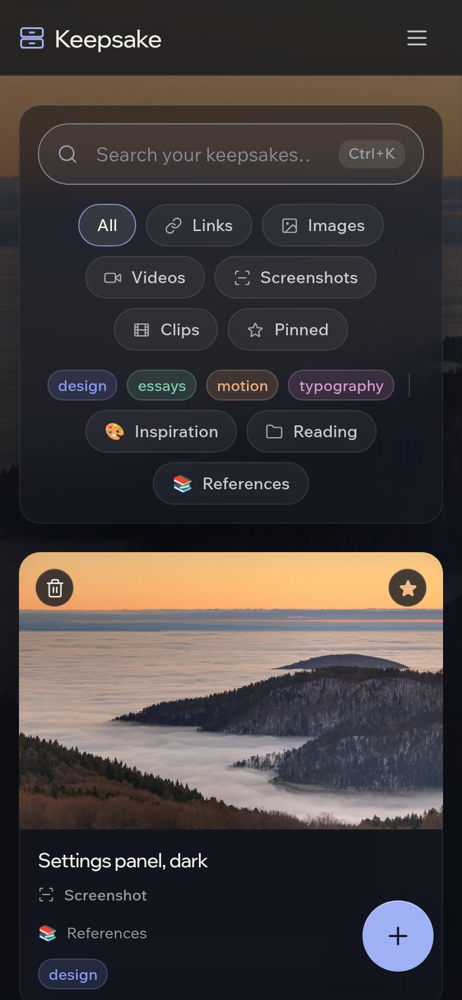

# Keepsake

A quiet, private vault for the things you save: links, images, videos, screenshots and clips. Self-hosted, on an isolated SQLite database with local file storage, with no external trackers and no telemetry.



## Features

- **Save links** and Keepsake fetches the page title, description, preview image and favicon from its OpenGraph tags.
- **Upload files**: images, videos, screenshots and clips, up to 100 MB each, by drag and drop or file picker.
- **Organise** with colour-coded tags and categories with their own icons, and pin the items you return to.
- **Find things fast**: search, filter by type, tag, category or pinned, and press `Ctrl+K` to jump to search.
- **Private by default**: everything lives in your own database and storage folder.

## Screenshots

| Dashboard | Save something new |
| --- | --- |
|  |  |

| Item | Mobile |
| --- | --- |
|  |  |

The screenshots show a demo account with sample items.

## Stack

- [Laravel](https://laravel.com) 13 on PHP 8.3+
- [Inertia.js](https://inertiajs.com) with Vue 3
- [Tailwind CSS](https://tailwindcss.com) 3, with a token-driven design layer in `resources/css`
- [Vite](https://vitejs.dev) and [Ziggy](https://github.com/tighten/ziggy) for routes in JavaScript
- SQLite

## Getting started

You need PHP 8.3+, Composer, Node.js and npm.

```sh
git clone https://github.com/yudhvir01/keepsake.git
cd keepsake

composer install
cp .env.example .env
php artisan key:generate

touch database/database.sqlite
php artisan migrate
php artisan storage:link

npm install --ignore-scripts
```

Then run the app in two terminals:

```sh
php artisan serve   # http://localhost:8000
npm run dev         # Vite dev server with hot reloading
```

Create an account from the landing page and start saving.

> This project is developed against the Vite dev server only. Do not run `npm run build` or commit anything in `public/build`.

### Tests

```sh
php artisan test
```

## Design

The interface is a dark, minimal system with smoked-glass surfaces and one periwinkle accent.

- `resources/css/tokens.css`: colours, type, spacing, motion and glass tokens
- `resources/css/base.css`: reset and global rules
- `resources/css/ui.css`: shared components (glass, buttons, fields, chips, cards, modals)
- `resources/js/Components/TypeIcon.vue`: the single SVG icon set

Animations use only `transform` and `opacity` and are switched off under `prefers-reduced-motion`.

## Credits

The background photograph is by [Thomas Bresson](https://commons.wikimedia.org/wiki/File:Vallee-brouillard.jpg), licensed [CC BY 3.0](https://creativecommons.org/licenses/by/3.0/), via Wikimedia Commons.

## Contributing

Commit messages are written as the developer's own. Do not add AI attribution lines such as `Co-Authored-By: Claude` or "Generated with Claude Code" to commits or pull requests. A `commit-msg` hook in `.githooks/` enforces this; enable it once per clone:

```sh
git config core.hooksPath .githooks
```

## License

Released under the [MIT license](https://opensource.org/licenses/MIT).
